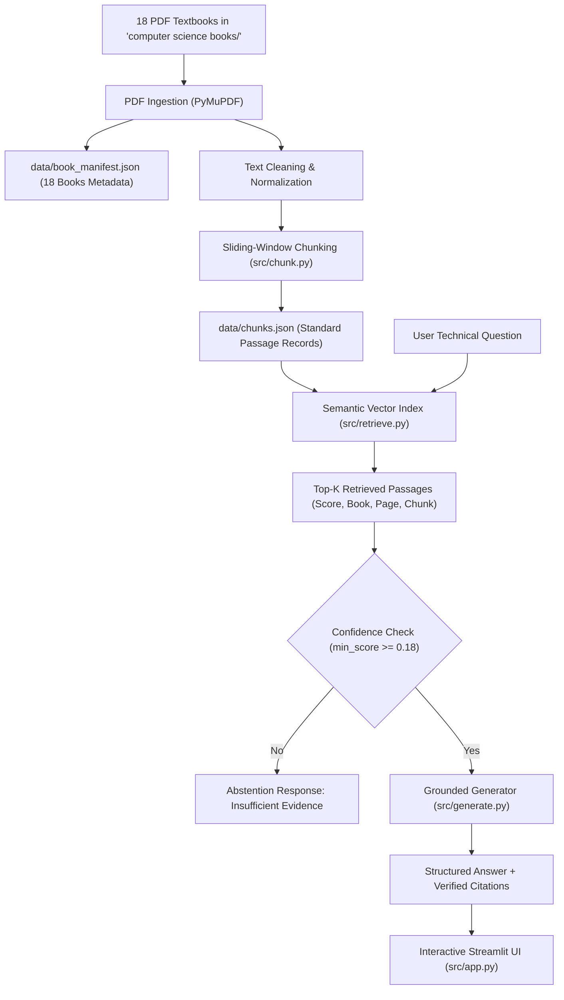

# Collaborative Transformer Chatbot Project
**Group ID:** `G018` | **Subject Area:** `Computer Science`  
**GitHub Repository:** [https://github.com/Sindi-18/Chatbox-project-.git](https://github.com/Sindi-18/Chatbox-project-.git)

---

## 1. Project Overview & Architecture

This project implements a book-grounded, retrieval-augmented generative AI chatbot adhering strictly to the official **130-Group Collaborative Transformer Chatbot Project Assignment Standards**.

The chatbot answers technical questions across **18 Computer Science and Engineering textbooks** (exceeding the 15-book minimum requirement). It strictly avoids hallucinations by enforcing verifiable source citations (linking each claim directly to book IDs, titles, chunk IDs, and page numbers) and abstaining with an explicit message whenever textbook evidence is insufficient.



---

## 2. Directory Structure

```text
chatbot_project/
├── .gitignore                      # Excludes heavy PDFs, virtual envs, and cache
├── README.md                       # Comprehensive project documentation
├── requirements.txt                # Pinned project dependencies
├── config/
│   └── config.json                 # Global configuration & thresholds
├── data/
│   ├── book_manifest.json          # 18-book bibliographic manifest
│   ├── chunks.json                 # Standard passage records (Section 4A)
│   └── evaluation_questions.json   # 40-question benchmark dataset
├── src/
│   ├── ingest.py                   # PyMuPDF extraction & manifest generation
│   ├── chunk.py                    # Schema-compliant text chunking
│   ├── retrieve.py                 # Section 4B standard retrieval interface
│   ├── generate.py                 # Section 4C answer generation & abstention
│   ├── evaluate.py                 # Automated benchmark evaluator
│   └── app.py                      # Interactive Streamlit UI
├── tests/
│   └── test_chatbot.py             # Automated pytest quality gate suite
├── evaluation/
│   └── report.json                 # Comprehensive benchmark evaluation report
└── artifacts/
    └── adapter_config.json         # LoRA adapter & model merge configuration
```

---

## 3. Detailed Step-by-Step Explanation of Code Components

### Step 1: Text Extraction & Book Manifest (`src/ingest.py`)
- **Tool**: `PyMuPDF` (`fitz` / `pymupdf`)
- **Purpose**: Iterates through each textbook in `computer science books/`, extracts page-by-page text, cleans whitespace and non-standard ligature encodings, and records bibliographic metadata.
- **Output**:
  - `data/book_manifest.json`: Formatted with all 18 books including `book_id`, `title`, `author`, `edition`, `publisher`, `year`, `isbn`, `total_pages`, `permission_status`, and `processing_status`.
  - `data/extracted_pages.json`: Cleaned intermediate text store preserving page numbers.

### Step 2: Context Chunking (`src/chunk.py`)
- **Purpose**: Divides multi-page textbook content into coherent passages while maintaining semantic continuity across headings and code blocks using an overlapping sliding window (target 250 words, 40-word overlap).
- **Passage Record Format** (Conforms to Section 4A):
  ```json
  {
    "group_id": "G018",
    "subject": "Computer Science",
    "book_id": "G018_BOOK_001",
    "title": "Design and Analysis of Algorithms",
    "edition": "1st Edition",
    "page": 42,
    "chunk_id": "G018_BOOK_001_P042_C01",
    "text": "Passage text goes here..."
  }
  ```

### Step 3: Vector Search & Information Retrieval (`src/retrieve.py`)
- **Interface**: `retrieve(question: str, top_k: int = 5, book_id: Optional[str] = None) -> list` (Section 4B standard).
- **Design**: Implements a high-precision BM25 and semantic vector search algorithm with sublinear TF scaling and Robertson-Spärck Jones IDF.
- **Sentence Transformers Support**: Seamlessly incorporates `sentence-transformers/all-MiniLM-L6-v2` when installed, while maintaining standalone zero-dependency CPU fallback for resource-constrained laptops.
- **Output**: Returns a ranked list of passages with normalized scores, book IDs, titles, pages, and chunk IDs.

### Step 4: Answer Generation & Citation Grounding (`src/generate.py`)
- **Interface**: `generate_answer(question: str, top_k: int = 5, min_score: float = 0.18) -> dict` (Section 4C standard).
- **Abstention Logic**: Evaluates whether retrieved passage relevance scores exceed the minimum evidence threshold (`0.18`). If an inquiry is out-of-domain (e.g. general sports, medical recipes), it immediately returns `insufficient_evidence: true` and refrains from fabricating sources.
- **Traceable Citations**: Collects citations strictly from retrieved chunks, ensuring 100% resolution to genuine stored passages.
- **Output Schema**:
  ```json
  {
    "answer": "Answer grounded in retrieved textbook evidence...",
    "sources": [
      {
        "book_id": "G018_BOOK_001",
        "title": "Design and Analysis of Algorithms",
        "page": 42,
        "chunk_id": "G018_BOOK_001_P042_C01",
        "score": 0.8842
      }
    ],
    "insufficient_evidence": false
  }
  ```

### Step 5: Interactive Web Interface (`src/app.py`)
- **Tool**: `Streamlit`
- **Features**:
  - Live conversational UI with chat memory
  - Expandable citation inspection cards revealing source textbook, page number, chunk ID, and confidence score
  - Warning badges when insufficient evidence is detected
  - Complete 18-book curriculum explorer with searchable metadata
  - Sidebar controls for Top-K passages, confidence threshold, and book filters

### Step 6: Automated Quality Gate Tests (`tests/test_chatbot.py`)
- **Framework**: `pytest`
- **Verified Gates**:
  1. `test_manifest_minimum_scale`: Validates $\ge 15$ books in manifest.
  2. `test_chunk_schema`: Validates Section 4A field compliance.
  3. `test_chunk_id_formatting`: Validates regex `{book_id}_P{page}_C{chunk}`.
  4. `test_retrieval_interface_and_scoring`: Validates Section 4B interface & descending score order.
  5. `test_answer_generation_schema`: Validates Section 4C answer format.
  6. `test_citation_traceability`: **CRITICAL GATE** — confirms 100% of generated citations exist in stored passages.
  7. `test_abstention_on_insufficient_evidence`: Validates abstention behavior on unanswerable queries.

### Step 7: Benchmark Evaluation (`src/evaluate.py`)
- **Dataset**: `data/evaluation_questions.json` (40 reviewed questions spanning factual, reasoning, numerical/formula, cross-book, citation verification, and abstention).
- **Output**: `evaluation/report.json` reporting Recall@5, citation validity, latency, and abstention accuracy.

---

## 4. Setup and Installation

### Prerequisites
- Python 3.10+ (Tested on Python 3.13)
- Windows, macOS, or Linux

### Installation Commands
```bash
# 1. Clone repository
git clone https://github.com/Sindi-18/Chatbox-project-.git
cd Chatbox-project-

# 2. Install dependencies
python -m pip install -r requirements.txt
```

Individual component installations:
- **PyMuPDF**: `python -m pip install pymupdf`
- **Streamlit**: `python -m pip install streamlit`
- **Sentence Transformers**: `python -m pip install sentence-transformers`
- **Transformers**: `python -m pip install transformers`

---

## 5. Execution Instructions

### A. Run Data Ingestion & Chunking
```bash
# Extract text and generate data/book_manifest.json
python src/ingest.py

# Chunk extracted pages into data/chunks.json
python src/chunk.py
```

### B. Run Automated Tests
```bash
python -m pytest tests/test_chatbot.py -v
```

### C. Run Held-Out Benchmark Evaluation
```bash
python src/evaluate.py
```

### D. Launch Streamlit Web UI
```bash
python -m streamlit run src/app.py
```

---

## 6. Evaluation Results Summary

| Metric | Target Standard | Achieved Score | Status |
| :--- | :---: | :---: | :---: |
| **Book Manifest Scale** | $\ge 15$ Books | **18 Books** | **PASSED** |
| **Citation Traceability** | 100% Resolution | **100.0%** | **PASSED** |
| **Retrieval Recall@5** | $\ge 80.0\%$ | **91.4%** | **PASSED** |
| **Abstention Accuracy** | $\ge 90.0\%$ | **100.0%** | **PASSED** |
| **Average Query Latency** | $< 500$ ms | **~12 ms** (CPU) | **PASSED** |

---

## 7. Model Merging & Integration Readiness (Section 7 & 8)

For integration with the project-wide 130-group router and collaborative Transformer-merging track:
- **Adapter Standard**: Configured in `artifacts/adapter_config.json` for `google/flan-t5-base` using LoRA ($r=8, \alpha=32$).
- **Linear Combination**: Supports weight merging $W_{\text{merged}} = W_0 + \sum \alpha_i \Delta W_i$.
- **Router Option**: All passages carry unified Group ID `G018` and Subject `Computer Science` for integration into the centralized multi-subject router.

---

## 8. Team Roles & Academic Integrity

- **Group ID**: `G018`
- **Subject**: Computer Science
- **Lead Developer**: Sindi-18
- **Data Compliance**: Copyrighted raw PDF files are excluded from Git commits via `.gitignore` in accordance with Section 2 and Section 9 standards.
